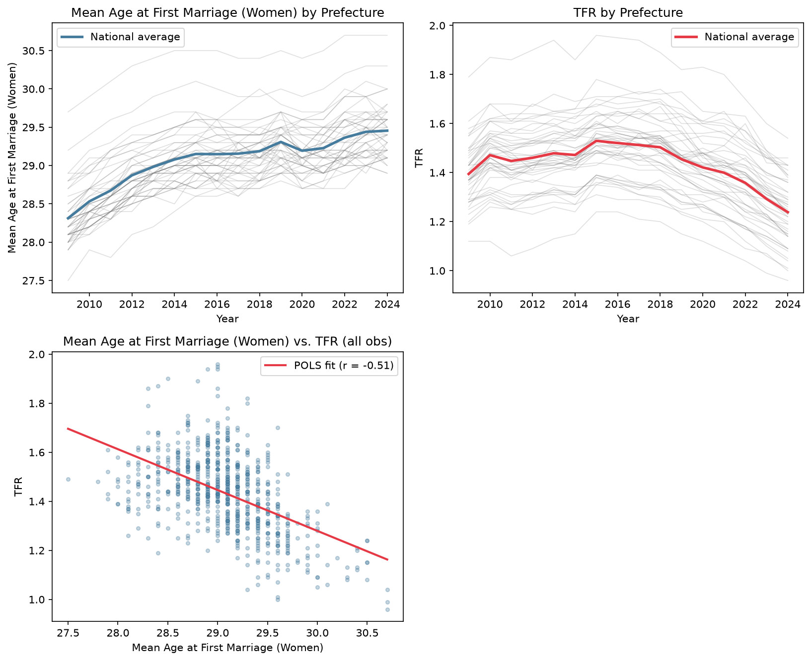
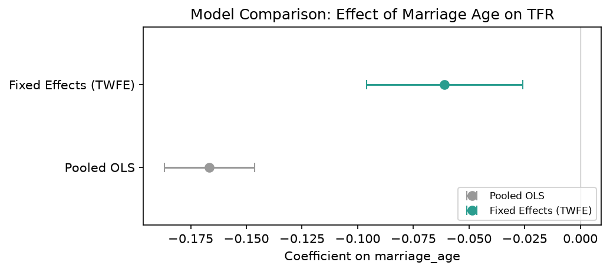
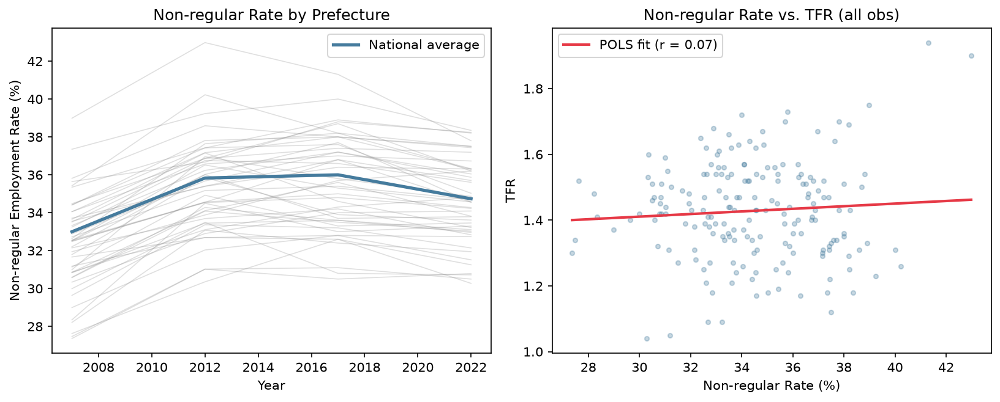
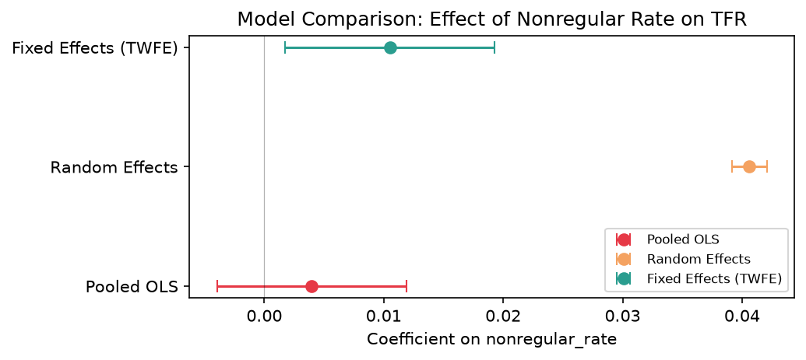
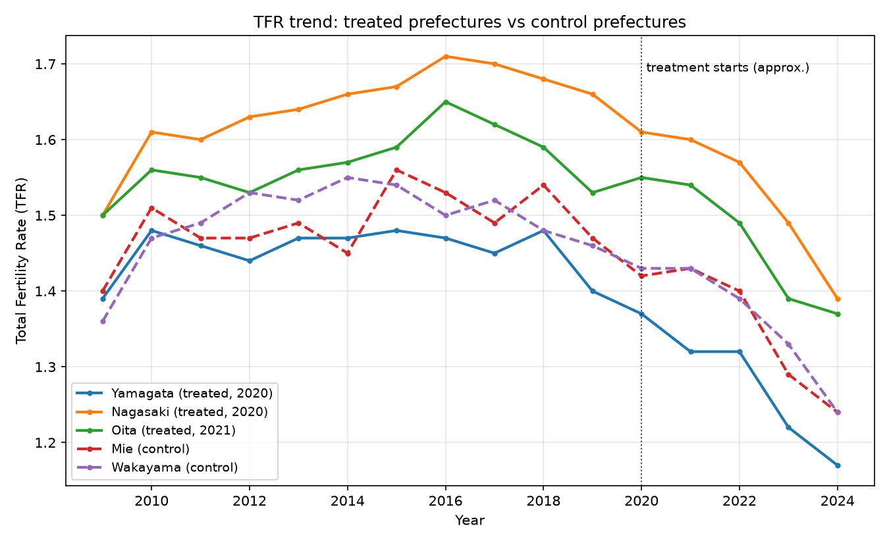
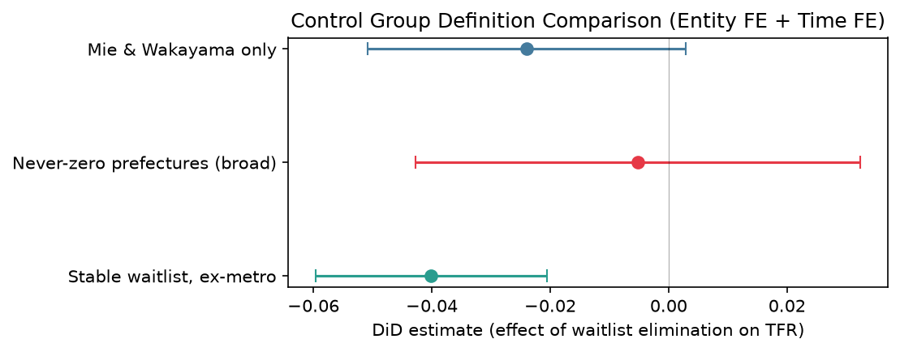
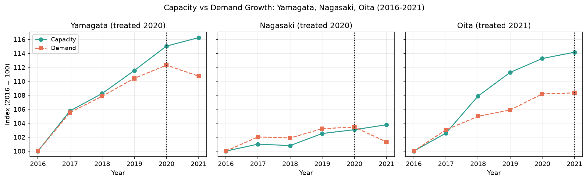
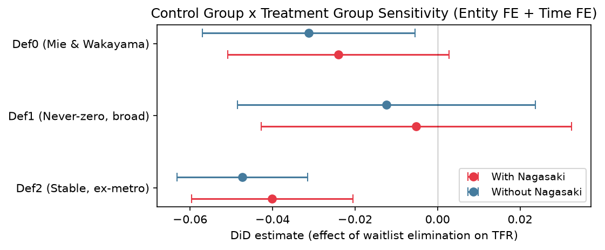

# Japan Fertility Causal Analysis

47都道府県のパネルデータを用いて、合計特殊出生率（TFR）と各種変数の関係を分析する。前半（Part 1）は固定効果パネル回帰による相関構造の分析、後半（Part 2）は差分の差分法（DiD）による「待機児童ゼロ化政策」の因果効果の推定である。

## Overview

- **Part 1-1**：女性の平均初婚年齢とTFRの関係（固定効果パネル回帰）
- **Part 1-2**：非正規雇用率とTFRの関係（固定効果パネル回帰）
- **Part 2**：待機児童ゼロ化政策がTFRに与える因果効果（DiD）

Part 1は相関関係の分析であり、交絡変数バイアスをどこまで除去できるかという視点でPOLS・FE・REの3モデルを比較する。Part 2は特定の政策介入（待機児童ゼロ化）の因果効果を推定する分析であり、処置群・対照群の設定や並行トレンド仮定の検証など、DiDに固有の論点を扱う。

-----

## Data

| データ | 出典 | 期間 |
| --- | --- | --- |
| 合計特殊出生率（TFR） | 厚生労働省「人口動態統計」 | 2009〜2024年 |
| 女性の平均初婚年齢 | 厚生労働省「人口動態統計」 | 2009〜2024年 |
| 非正規雇用率 | 総務省統計局「就業構造基本調査」 | 2007, 2012, 2017, 2022年（4時点） |
| 待機児童数（全都道府県） | 厚生労働省/こども家庭庁「保育所等関連状況取りまとめ」（資料3） | 2016〜2024年（Excelで手動集計） |
| 利用定員数・利用児童数・待機児童数（処置群・対照群候補県のみ） | 厚生労働省「保育所等関連状況取りまとめ」（資料3） | 2016〜2021年（Pythonで直接読み込み） |

- 非正規雇用率は「非正規の職員・従業員数 ÷ 雇用者総数（役員含む）× 100」として定義し、自営業主・家族従業者は分母から除外している。
- 待機児童数は全都道府県分を手動集計、利用定員数・利用児童数は処置群の妥当性検証用に対象県のみPythonで個別処理した。

-----

## Part 1: Fixed Effects Panel Regression

TFRとの相関を、プールドOLS（POLS）・固定効果モデル（FE）・変量効果モデル（RE）の3モデルで比較する。POLSは都道府県固有の交絡（地域経済の魅力度など）をそのまま含むベースラインであり、FEはそれを県固定効果として除去する。REとの比較はハウスマン検定的な解釈のために行っている。

### Part 1-1：女性の平均初婚年齢

- 左上のグラフを見ると、どの都道府県も女性の平均初婚年齢の長期トレンドは上昇傾向にあり、全国平均は2009年の28.6歳から2024年の29.8歳へと15年で1.2歳上昇している。都道府県別に見ると東京都の平均初婚年齢が最も高く、2011年以降30歳を超えている。
- 右上のグラフを見ると、合計特殊出生率の全国平均は2009年の1.37から2015年の1.45まで緩やかな回復傾向にあったが、その後は下落傾向にあり、2024年には1.15まで低下している。都道府県別に見ると沖縄県が常に全国1位であり、2010年代は1.8以上を維持していた。一方全国ワーストは東京都であり、2023年以降1.0を下回っている。
- 左下の初婚年齢と出生率の散布図を見ると、中程度の負の相関（r = -0.51）があることがわかる。ただしこれはPOLSの関係であり、県間の水準差も含んだ見かけ上の相関である。

| モデル | 係数 | p値 |
| --- | --- | --- |
| プールドOLS | -0.1666 | <0.0001 |
| 固定効果（FE） | -0.0609 | 0.0007 |

FEで係数の絶対値がPOLSの約1/3に縮小した。女性の平均初婚年齢が1歳上がるごとにTFRが約0.06減少するという関係が、都道府県固有の交絡を除去してもなお残る。ただし、県固有の時間変動する景気ショック（例：大手工場の閉鎖が結婚の先延ばしと出生率低下を同時に引き起こす等）は県FE・時間FEのいずれでも吸収できず、擬似相関の可能性は完全には排除できない。

-----

### Part 1-2：非正規雇用率

- 左のグラフを見ると、非正規雇用率の全国平均は2017年の36.0%をピークに低下傾向にある。都道府県別では2007年・2012年・2017年の3時点で沖縄県が最も高くなっている。
- 右の非正規雇用率と出生率の散布図を見ると、ほとんど無相関（r = 0.07）であることがわかる。ただしこれもPOLSの関係であり、県間の水準差も含んだ見かけ上の相関である。

| モデル | 係数 | p値 |
| --- | --- | --- |
| プールドOLS | +0.00397 | 0.324（有意でない） |
| 固定効果（FE） | +0.01052 | 0.019（有意） |

非正規雇用率が1ポイント上がるごとにTFRが約0.01上昇するという、直感に反する正の符号がFEで有意に検出された。POLSでは非正規雇用率の高い県ほどTFRも高い傾向（地方 vs 都市の構造）が真の負の効果を打ち消していた可能性がある一方、FEはこの構造を除去した上で「同一県内で非正規雇用率が上がった年はTFRも上がる」という県内変動を捉えている。この結果については、県内の好景気が非正規雇用率の上昇（パート・アルバイト需要の増加）とTFRの上昇を同時に引き起こす擬似相関である可能性が高いと考えている（Project 3の分析結果とも整合的）。

-----

## Part 2: Difference-in-Differences

「待機児童ゼロ化」政策がTFRに与えた因果効果をDiDで推定する。

| 変数 | 内容 |
| --- | --- |
| `treated` | 処置群ダミー（処置群=1、対照群=0） |
| `post` | 政策後ダミー（2020年以降=1） |
| `treated:post` | 交差項＝DiD推定量 |
| `tfr` | 合計特殊出生率（目的変数） |

### 処置群・対照群の設定

処置群の候補は、ある時点までは待機児童数が一定数いて、その後ゼロになった県とした：山形県（2020年〜ゼロ）、長崎県（2020年〜ゼロ）、大分県（2021年〜ゼロ）。このうち大分県は処置タイミングが異なる（staggered treatment）ため、山形県・長崎県（ともに2020年処置）のみをメインのDiD分析に含めた。対照群の初期候補は、分析期間を通じて待機児童数が一貫して多い三重県・和歌山県とした。

### 並行トレンド仮定の検証

処置前期間について交差項付き回帰（`year_c:treated`）を行ったところ、係数は0.0013、p=0.715で全く有意ではなかった。これは処置群と対照群のTFRトレンドの傾きに統計的な差が見られないことを意味し、並行トレンド仮定を支持する結果である。ただし、対象がわずか5県であるため、クラスター数不足によりクラスター頑健標準誤差の理論的前提（目安30〜50クラスター以上）を満たしていない点には注意が必要である。

### メインのDiD推定

三重県・和歌山県のみを対照群とした2×2 DiD（`tfr ~ treated + post + treated:post`）の結果、`treated:post`の係数は-0.0240、p=0.055であった。点推定値だけを見れば、待機児童ゼロ化はTFRを押し上げるどころか押し下げる方向に効いているが、p値は慣例的な有意水準5%をわずかに上回っており、「効果があるともないとも言い切れない」という結果である。

### 対照群の定義による頑健性チェック

対照群の定義を変えて同一の県FE＋年FEモデル（`tfr ~ did + EntityEffects + TimeEffects`）を3通り実行し、結果が定義にどれだけ依存するかを検証した。

| 定義 | 対照群 | 県数 | DiD推定量 | p値 |
| --- | --- | --- | --- | --- |
| 定義0 | 三重・和歌山のみ | 4 | -0.0240 | 0.0773 |
| 定義1 | 分析期間中一度も待機児童ゼロを達成していない県（広義、主要都市圏を除く） | 11 | -0.0051 | 0.786 |
| 定義2 | 2024年時点で待機児童数が2016年比20%以上残っている県（主要都市圏を除く） | 8 | -0.0401 | 0.0001 |

3つの定義で推定値・有意性がいずれも異なっており、対照群の定義に結果が大きく依存することが分かる。1つの結果だけを報告するのではなく、こうした定義依存性を透明性を持って示すことを本分析の主眼の一つとしている。

### 処置群の妥当性検証：定員（供給）と需要の分解

待機児童ゼロの達成が「保育所整備（供給拡大）」によるものか「需要縮小」によるものかを区別するため、2016年から各県の処置年までの保育定員成長率と需要成長率を比較した。

| 県 | 定員成長率 | 需要成長率 | 差 |
| --- | --- | --- | --- |
| 山形県 | +15.0% | +12.3% | +2.7pt |
| 長崎県 | +3.1% | +3.4% | -0.4pt |
| 大分県 | +14.2% | +8.3% | +5.8pt |

山形県・大分県は定員成長率が需要成長率を明確に上回っており、需要増を上回るペースで保育所整備を進めた結果としてゼロ達成に至ったと解釈できる。一方、長崎県は定員成長率が需要成長率をわずかに下回っており、積極的な政策努力というより需要の伸びがたまたま緩やかだったことによるゼロ達成である可能性が高い。この結果から、長崎県を処置群に含めることの妥当性に疑問が生じた。

### 感度分析：長崎県を処置群から除外

長崎県を処置群から除外し、山形県のみを処置群として3つの対照群定義を再検証した。

| 定義 | 長崎県を含む | 長崎県を除外 |
| --- | --- | --- |
| 定義0 | -0.0240（p=0.077） | -0.0312（p=0.021） |
| 定義1 | -0.0051（p=0.786） | -0.0124（p=0.496） |
| 定義2 | -0.0401（p=0.0001） | -0.0473（有意） |

長崎県を除いても負の効果という方向性は変わらず、むしろ係数はより負に強まった。有意性の判定が実質的に変化したのは定義0（非有意→有意）のみである。これは「長崎県が結果を歪めていたために負の効果が出ていた」という単純な話ではなく、真正な供給拡大による待機児童ゼロを達成した山形県単独で見ても、対照群よりTFRの低下が大きいことを示している。

### 解釈

山形県は需要増を上回るペースで供給拡大を行った「真正な政策効果を持つ処置群」であることが定員・需要データから確認されている。にもかかわらず山形県単独でもTFRの低下が対照群より大きいという結果は、「見せかけのゼロ化（逆の因果関係）」という仮説では説明できない。残る解釈は次の2つである。

1. **両立支援のジレンマ仮説**：保育所整備が就労と育児の両立を可能にする一方、（第一子の育児と就労の両立経験を通じて）第二子以降を持つことの機会費用の意識を高め、追加の出産をためらわせている可能性
2. **統計的ノイズ**：処置群が最大でも2県、対照群も4〜11県という非常に小さいサンプルサイズに起因するノイズである可能性

現時点ではどちらとも判別できず、両仮説を併記するにとどめている。

-----

## Limitations

- **クラスター数の不足**：対照群の定義によってはクラスター数が4〜5にとどまり、クラスター頑健標準誤差の理論的前提（目安30〜50以上）を満たしていない
- **特定化探索（specification search）のリスク**：対照群の定義次第で結果が変わるため、1つの定義だけを報告するとcherry-pickingの疑いが生じる。本分析では複数の定義を透明性を持って併記することで対処している
- **COVID-19の交絡**：処置年（2020〜2021年）が新型コロナウイルスの影響と重なるため、単純な2×2 DiDから県FE＋時間FEのパネルモデルへ移行することで年次共通ショックを除去した
- **「待機児童ゼロ」達成の内生性**：ゼロ達成は供給拡大だけでなく需要縮小によっても生じうるため、定員・需要データによる処置群の妥当性検証を追加で行った
- **対照群への既処置県混入リスク**：分析期間開始前からすでに待機児童ゼロを達成していた県は対照群候補から除外し、「一度もゼロを達成していない」県のみを対照群候補とした

-----

## Tech Stack

`pandas` / `statsmodels` / `linearmodels`（`PanelOLS`, `RandomEffects`）/ `matplotlib`
